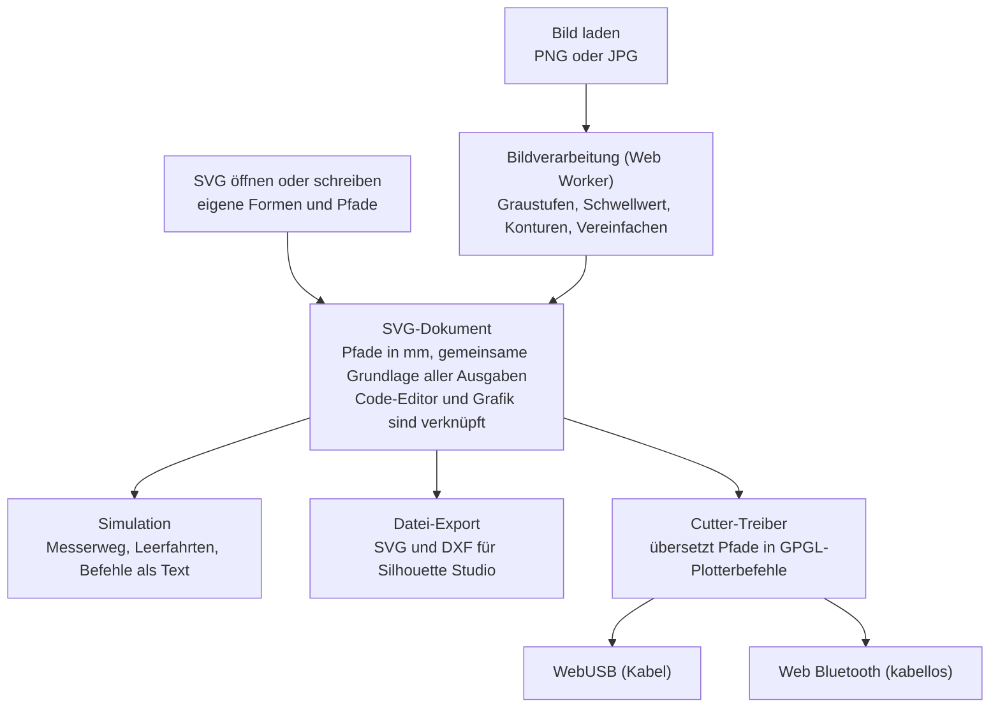

# Anforderungen: Vom Pixel zum Schnitt

Web-App zum Lernen über SVG und Schneideplotter · Stand: 31.10.2026

## Ziel und Zielgruppe

Die Web-App zeigt Schritt für Schritt, wie aus einem Pixelbild Schnittpfade für einen Schneideplotter werden, und bringt dabei SVG bei. Vorbild ist die Nachzeichnen-Funktion von Silhouette Studio, nur ohne Blackbox.

- **Zielgruppe:** Oberstufe und Studierende. Algorithmen, Koordinaten und Code dürfen offen gezeigt werden.
- **Einsatz:** freies Werkzeug, kein geführter Kurs. Gelernt wird durch Ausprobieren und durch einblendbare Erklärungen.
- **Geräte:** Windows-PCs ohne Adminrechte und macOS-Notebooks, jeweils mit Chrome oder Edge.
- **Cutter:** Silhouette-Geräte (Cameo, Portrait). Ausgabe per WebUSB, Web Bluetooth oder als SVG- bzw. DXF-Datei.
- **Offen:** Welche Cutter-Modelle und welche Studio-Edition gibt es an der Schule genau?

## Leitprinzipien

Jeder Verarbeitungsschritt ist sichtbar und einstellbar, nichts passiert verborgen.

1. **Durchsichtige Pipeline:** Zu jedem Schritt gibt es eine Darstellung seiner Daten: Pixelwerte, 0/1-Matrix, Punktliste, SVG-Code, Plotterbefehle. Man sieht, was ein Schritt bekommt und was er liefert.
2. **Schrittweise Vertiefung:** Die Standardansicht ist ein schlankes Werkzeug. Detailansichten und Erklärungen („Wie funktioniert das?“) sind aufklappbar.
3. **Verknüpfte Ansichten:** Grafik und Code sind synchron. Eine Auswahl in der Grafik markiert den Code und umgekehrt.
4. **Das SVG-Dokument ist die gemeinsame Grundlage:** Was im SVG-Code steht, wird simuliert, exportiert und geschnitten. Wer SVG von Hand schreibt, kann es genauso schneiden wie ein nachgezeichnetes Bild.
5. **Reine Browser-App:** Kein Server, kein Login, keine Datenübertragung. Bilder bleiben auf dem Gerät, das vereinfacht den Datenschutz an Schulen.
6. **Ohne Hardware nutzbar:** Die Simulation ersetzt den Cutter, damit der Unterricht nicht an Geräten hängt.

## Bild-zu-Pfad-Pipeline

Das Nachzeichnen besteht aus acht Schritten; jeder hat eine eigene Ansicht und reagiert live auf seine Regler.

| Schritt | Was man sieht | Was man einstellt | Lerninhalt |
| --- | --- | --- | --- |
| 1. Bild laden | Bild, Zoom bis auf einzelne Pixel mit RGB-Werten | Datei (PNG, JPG) per Drag & Drop, Zuschnitt | Rastergrafik, Auflösung, Farbmodell |
| 2. Graustufen | Graubild und die verwendete Formel | Mittelwert oder gewichtete Luminanz | Farbe in Helligkeit umrechnen |
| 3. Schwellwert | Schwarz-Weiß-Bild, Histogramm, 0/1-Matrix im Zoom | Schwellwert-Regler, Automatik (Otsu), Invertieren | Binarisierung, Histogramm |
| 4. Entrauschen (optional) | Vorher/nachher, entfernte Flecken markiert | Mindestfläche in Pixeln | Zusammenhängende Bereiche |
| 5. Konturen finden | Konturen über dem Bild, Schritt für Schritt animierbar | Animationstempo | Marching Squares, Außen- und Innenkonturen |
| 6. Vereinfachen | Punkte als Marker, Punktzahl vorher/nachher | Toleranz in Pixeln | Douglas-Peucker, Genauigkeit gegen Datenmenge |
| 7. Glätten (optional) | Linien gegenüber Bézier-Kurven, Kontrollpunkte | An/aus, Glättungsstärke | Bézier-Kurven |
| 8. SVG erzeugen | SVG-Code neben der Grafik, synchron markiert | Zielgröße in mm, Position | SVG-Aufbau, Pfadbefehle, Einheiten, `fill-rule` für Löcher |

- Rechenintensive Schritte laufen in einem Web Worker, damit die Oberfläche flüssig bleibt.
- Bilder bis etwa 2000 × 2000 Pixel sollen ohne spürbare Wartezeit verarbeitet werden.
- Jeder Zwischenstand lässt sich als Bild oder Daten exportieren, z. B. für Arbeitsblätter oder eigene Auswertungen.

Für bessere Ergebnisse lassen sich die Schritte 5 bis 7 wahlweise durch Potrace oder VTracer ersetzen (siehe „Lizenz und Bildtracer“).

## SVG-Ansicht und Lernfunktionen

Der SVG-Code ist jederzeit sichtbar und editierbar, und er ist die Grundlage für jeden Schnitt.

- **Code-Editor mit Live-Vorschau:** Änderungen erscheinen sofort in der Grafik. Fehler werden an der Stelle markiert, statt dass die Vorschau leer bleibt.
- **Grafik und Code verknüpft:** Hover oder Klick auf einen Pfad markiert das Element im Code und umgekehrt. Bei `<path>` wird zusätzlich der einzelne Befehl (M, L, C, Z) markiert.
- **Pfad-Erklärer:** Ein `d`-Attribut wird Befehl für Befehl mit Bedeutung und Koordinaten aufgeschlüsselt. Punkte und Bézier-Kontrollpunkte lassen sich in der Grafik ziehen, der Code ändert sich mit.
- **Eigene SVGs:** SVG-Dateien öffnen oder von Hand schreiben (`rect`, `circle`, `ellipse`, `polygon`, `path`). Die Umrechnung von Formen in Pfade für den Schnitt ist sichtbar.
- **Koordinaten und Einheiten:** Raster und Lineal in mm, Ursprung oben links, y-Achse nach unten. Hinweis bei fehlender Einheit oder fehlender `viewBox`.
- **Cutter-Checks mit Erklärung**, die zeigen, wie ein Cutter „denkt“:
  - Füllungen werden ignoriert, geschnitten werden nur Konturen.
  - Offene und geschlossene Pfade werden unterschieden.
  - Innenkonturen (Löcher) werden vor der Außenkontur geschnitten.
  - Bei Schablonen fallen Inseln heraus, z. B. das Innere eines „O“.
  - Warnungen bei doppelten oder winzigen Segmenten und bei Objekten außerhalb der Matte.
- **Beispiele und Mini-Aufgaben:** Mitgelieferte Beispiel-SVGs und kurze Aufgaben als optionale Karten, ohne Kursmodus.

## Ausgabe: Simulation, Cutter, Export

Es gibt vier Ausgabewege: Simulation und Datei-Export funktionieren immer, die direkte Ansteuerung je nach Plattform.

**Schnitt-Simulation**

- Spielt den Messerweg ab: Schnitte und Leerfahrten in verschiedenen Farben, Startpunkt und Richtung je Pfad.
- Zeigt Schnittlänge, Länge der Leerfahrten und geschätzte Dauer.
- Schnittreihenfolge wählbar (Original, innen vor außen, nächster Nachbar), mit Vergleich der Leerfahrten.
- Zeigt die erzeugten Plotterbefehle als Text, Zeile für Zeile synchron zur Animation.

**Direkt an den Cutter per WebUSB (Kabel)**

- Verbindung über `navigator.usb` mit Gerätefilter auf die Hersteller-ID `0x0B4D` (Graphtec/Silhouette).
- Erwarteter Hauptweg auf macOS. Unter Windows nur nach Treibertausch auf WinUSB (Adminrechte); trotzdem einbauen und den Fehlerfall verständlich erklären.
- Statusabfrage vor dem Senden (bereit, in Bewegung, keine Matte geladen).

**Direkt an den Cutter per Web Bluetooth**

- Für Bluetooth-fähige Modelle. Hauptweg auf Windows-PCs ohne Adminrechte, sofern sie Bluetooth haben.
- Gleiche Plotterbefehle wie bei USB, nur ein anderer Übertragungsweg.

**Datei-Export**

- SVG (in mm, bereinigt) und DXF.
- DXF ist Pflicht, weil die kostenlose Basic Edition von Silhouette Studio keine SVG-Dateien öffnet, DXF aber schon.

**Einstellungen und Sicherheit beim Senden**

- Werkzeug (Stift oder Messer), Druck, Geschwindigkeit, Mattengröße; Presets für typische Materialien, Werte im Machbarkeitstest ermitteln.
- Vorschau der Lage auf der Matte vor dem Senden, Warnung bei Objekten außerhalb.
- Gut sichtbarer Abbrechen-Knopf; wie das Gerät auf einen Abbruch reagiert, klärt der Machbarkeitstest.
- Hinweis in der Oberfläche: erste Versuche mit Stift statt Messer.

## Plattformen und technische Rahmenbedingungen

Zielplattform sind aktuelle Chromium-Browser (Chrome, Edge) auf macOS und Windows, denn nur dort gibt es WebUSB und Web Bluetooth.

| Plattform | WebUSB | Web Bluetooth | SVG-/DXF-Export |
| --- | --- | --- | --- |
| macOS, Chrome oder Edge | erwartet ja, kein Treibertausch nötig; Silhouette Studio darf das Gerät nicht belegen | ja; macOS fragt einmal nach der Bluetooth-Erlaubnis für den Browser | ja |
| Windows ohne Adminrechte | voraussichtlich nein, der Druckertreiber belegt das Gerät | ja, wenn der PC Bluetooth hat | ja |
| Windows mit Adminrechten | ja, nach Treibertausch auf WinUSB (z. B. mit Zadig) | ja | ja |
| Firefox, Safari | nein | nein | ja |

- Statische Web-App auf GitHub Pages, gebaut und veröffentlicht per GitHub Actions; ein Schulserver geht ebenso. HTTPS ist Pflicht, weil WebUSB und Web Bluetooth nur in sicheren Kontexten laufen; zur Entwicklung reicht `localhost`.
- Kein Server, kein Tracking, keine externen Ressourcen zur Laufzeit; alles wird mitgeliefert. Keine Funktionen, die eigene HTTP-Header brauchen (z. B. WASM-Threads mit SharedArrayBuffer), denn GitHub Pages erlaubt keine eigenen Header.
- Offline-fähig als PWA (wünschenswert).
- Funktionen ohne Hardware laufen in allen modernen Browsern. Fehlende Schnittstellen werden erkannt und erklärt, statt mit einem Fehler abzubrechen.
- Oberfläche auf Deutsch, Texte zentral gesammelt, damit eine englische Fassung später möglich ist.
- Bedienung mit Maus und Tastatur, ausgelegt für Notebook-Bildschirme ab 1280 px Breite.

## Nicht-Ziele

Die App ersetzt Silhouette Studio nicht, sondern macht einen Teil davon durchschaubar.

- Kein Print & Cut mit Passermarken, keine Design-Bibliothek, kein Shop.
- Kein vollwertiges Vektor-Zeichenprogramm wie Inkscape.
- Keine Optimierung für iPads oder Smartphones.
- Keine Nutzerkonten, keine Cloud-Speicherung.
- Keine Plotter anderer Hersteller (Cricut, Brother) in der ersten Version; die Treiber-Schnittstelle hält das für später offen.

## Ausbaustufen

Zuerst kommen der Machbarkeitstest für den Cutter und die Kern-Pipeline, die direkte Ansteuerung erst danach.

1. **Stufe 0 – Machbarkeitstest Cutter** (parallel zu Stufe 1): eine minimale Seite, die per WebUSB und Web Bluetooth verbindet und mit Stift ein Quadrat zeichnet. Checkliste siehe Risiken.
2. **Stufe 1 – Kern:** Pipeline mit allen acht Schritten, verknüpfte SVG-Ansicht, Schnitt-Simulation, Export als SVG und DXF.
3. **Stufe 2 – SVG lernen:** Code-Editor, Pfad-Erklärer, ziehbare Punkte, Cutter-Checks, Beispiele und Mini-Aufgaben.
4. **Stufe 3 – Direkte Ansteuerung:** WebUSB und Web Bluetooth im Normalbetrieb, mit Presets, Mattenvorschau und Abbruch.
5. **Stufe 4 – Erweiterungen**, je nach Bedarf:
   - Mehrfarbige Bilder in Farbebenen zerlegen, je Farbe ein Schnitt.
   - Text in Pfade umwandeln.
   - Automatische Brücken für Schablonen.
   - Konturen versetzen (Offset), z. B. für Aufkleberränder.
   - SVG per Programm erzeugen: ein kleiner Code-Bereich, dessen Ausgabe direkt geschnitten werden kann.

## Risiken und Machbarkeitstest

Das größte Risiko ist die direkte Ansteuerung. Sie wird deshalb vor allem anderen mit den echten Geräten der Schule geprüft.

| Risiko | Folge | Gegenmaßnahme |
| --- | --- | --- |
| Protokoll nicht offiziell dokumentiert, Unterschiede zwischen Modellen | Befehle laufen nicht auf allen Geräten | An Open-Source-Treibern orientieren, Geräteprofile je Modell, jedes Modell testen |
| Windows blockiert WebUSB ohne Treibertausch | Kein Kabelbetrieb auf Schul-PCs | Web Bluetooth und DXF-Export als gleichwertige Wege, klare Meldung in der App |
| Schul-PCs ohne Bluetooth | Unter Windows keine direkte Ansteuerung | DXF-Export und Silhouette Studio |
| Bluetooth-Details nur aus Open-Source-Code ableitbar | Bluetooth-Weg verzögert sich | Im Machbarkeitstest zuerst klären |
| Mehrere Cutter im Raum | Falsches Gerät verbunden | Gerätename und Status gut sichtbar, Knopf für eine kurze Testfahrt |
| Silhouette Studio belegt das Gerät | Verbindung schlägt fehl | Hinweis in der App: Studio schließen |

**Checkliste Machbarkeitstest**

- [ ] macOS mit Chrome: Cutter per WebUSB finden, Interface belegen, Statusabfrage senden.
- [ ] Mit Stift ein Quadrat von 50 mm zeichnen und die Maße nachmessen.
- [ ] Dasselbe per Web Bluetooth, auf macOS und auf einem Windows-PC.
- [ ] Windows ohne Adminrechte: Verhalten von WebUSB dokumentieren, inklusive Fehlermeldung.
- [ ] Prüfen, ob Silhouette Studio danach normal weiter funktioniert.
- [ ] Reaktion des Geräts auf einen Abbruch mitten im Auftrag prüfen.
- [ ] Mit allen Cutter-Modellen der Schule wiederholen.
- [ ] Exportierte DXF-Datei in der Basic Edition von Silhouette Studio öffnen: Maße und Pfade stimmen.

## Hinweise für die Umsetzung

Die App besteht aus getrennten Modulen rund um ein SVG-Dokument. Der Cutter-Treiber steckt hinter einer Schnittstelle, damit Simulation, WebUSB und Bluetooth austauschbar sind.

Bild und eigene SVG-Dateien münden in dasselbe SVG-Dokument; Simulation, Export und Cutter lesen nur daraus.

- **Technik (Vorschlag):** TypeScript, Vite, ein schlankes UI-Framework nach Wahl, Tests mit Vitest. Die Bildverarbeitung läuft in einem Web Worker.
- **Eigene Algorithmen:** Schwellwert, Otsu, Marching Squares, Douglas-Peucker und Bézier-Glättung selbst umsetzen und gut kommentieren. Der Code soll selbst als Lernmaterial lesbar sein.
- **Cutter-Schnittstelle:** z. B. `connect()`, `status()`, `send(job)` und `cancel()`, umgesetzt als `SimulatedCutter`, `WebUsbCutter` und `BluetoothCutter`. Ein Auftrag ist eine Liste von Polylinien in mm plus Werkzeugeinstellungen.
- **Befehlsübersetzung:** Die Umrechnung in GPGL-Befehle ist eine reine Funktion in einem eigenen Modul, abgesichert mit Snapshot-Tests. Dieselbe Ausgabe zeigt die Simulation als Text.
- **Protokoll-Referenzen:** [inkscape-silhouette](https://github.com/fablabnbg/inkscape-silhouette) mit [Commands.md](https://github.com/fablabnbg/inkscape-silhouette/blob/main/Commands.md), `silhouette/Graphtec.py` und dem Bluetooth-Abschnitt in `USERGUIDE.md`, außerdem [robocut](https://github.com/Timmmm/robocut). Code daraus darf portiert werden, weil die App GPL-2.0-kompatibel lizenziert ist; die Copyright-Hinweise bleiben erhalten. Laut Treiber arbeiten die Plotter intern in Schritten von 0,05 mm.
- **Lizenz:** GPL-2.0-or-later; Begründung und Pflichten im Abschnitt „Lizenz und Bildtracer“.
- **DXF-Export:** möglichst einfache DXF-Variante mit Linien bzw. Polylinien in mm; Kompatibilität mit der Basic Edition im Machbarkeitstest prüfen.

## Lizenz und Bildtracer

Die App steht unter **GPL-2.0-or-later**. Damit darf sie Potrace als hochwertigen Tracer mitliefern und Treibercode aus inkscape-silhouette übernehmen.

- Potrace steht unter GPL-2.0-or-later, die Browser-Fassung esm-potrace-wasm unter GPL-2.0. Eine App, die sie mitliefert, muss GPL-kompatibel sein.
- Der Cutter-Treiber `silhouette/Graphtec.py` erlaubt nur GPLv2 („Distribute under GPLv2 or ask“). Mit GPL-3.0 dürfte man ihn nicht übernehmen; GPL-2.0-or-later passt zu beidem.
- MIT wäre nur mit VTracer statt Potrace und ohne fremden Treibercode möglich.
- Folge: Alle dürfen die App nutzen, verändern und weitergeben, auch kommerziell. Weiterentwicklungen müssen aber wieder unter der GPL offen sein.

| Tracer | Lizenz | Stärke | Einsatz in der App |
| --- | --- | --- | --- |
| Eigener Tracer | GPL-2.0-or-later (eigener Code) | Jeder Schritt sichtbar und erklärbar | Standard, mit allen Zwischenansichten |
| Potrace über [esm-potrace-wasm](https://github.com/tomayac/esm-potrace-wasm) | GPL-2.0 | Referenz für Schwarz-Weiß mit glatten Bézier-Kurven, auch in Inkscape im Einsatz | Option „Beste Qualität“ für Schwarz-Weiß |
| [VTracer](https://github.com/visioncortex/vtracer), z. B. über das npm-Paket `vectortracer` | MIT | Auch Farbbilder und Fotos | Stufe 4: mehrfarbige Bilder |
| [imagetracerjs](https://github.com/jankovicsandras/imagetracerjs) | Unlicense | Einfach, Farbe möglich | Nicht nötig, höchstens zum Vergleich |

Die fertigen Tracer ersetzen nur die Schritte 5 bis 7; Graustufen und Schwellwert bleiben eigener Code. Eine Vergleichsansicht zeigt das eigene Ergebnis und das von Potrace nebeneinander, mit Zahl der Punkte und Kurven.

**Pflichten aus der GPL**

- [ ] `LICENSE` mit dem GPL-2.0-Text ins Repository, in `package.json` `"license": "GPL-2.0-or-later"`.
- [ ] Quellcode öffentlich machen (z. B. GitHub) und in der App verlinken, denn das ausgelieferte JavaScript gilt in der Regel als Weitergabe.
- [ ] Seite „Über und Lizenzen“ in der App mit allen Fremdbibliotheken und ihren Lizenzen.
- [ ] In übernommenen Dateien die Copyright-Hinweise behalten und die Herkunft im Code vermerken.
- [ ] Lizenzen immer am Original prüfen: Manche Wrapper-Pakete geben die Lizenz der eingebundenen Bibliothek falsch an.

## Quellen

- [inkscape-silhouette: unterstützte Geräte, Windows-Treiber, Bluetooth](https://github.com/fablabnbg/inkscape-silhouette)
- [Befehlsübersicht für Silhouette-Cutter (Commands.md)](https://github.com/fablabnbg/inkscape-silhouette/blob/main/Commands.md)
- [Silhouette Web: Überblick, nur für Bluetooth-Maschinen](https://silhouetteamerica.freshdesk.com/support/solutions/articles/35000277151-silhouette-web-overview)
- [Silhouette Studio: SVG öffnen erst ab Designer Edition](https://silhouetteamerica.freshdesk.com/support/solutions/articles/35000273385-business-edition-features)
- [Chromium: gesperrte Geräteklassen bei WebUSB](https://groups.google.com/a/chromium.org/g/blink-dev/c/LZXocaeCwDw/m/GLfAffGLAAAJ)
- [Treiberzugriff auf USB-Drucker unter Windows, macOS und Linux](https://thermal-label.github.io/connecting)
- [Potrace: GPL-2.0-or-later, kommerzielle Lizenz über Icosasoft](https://en.wikipedia.org/wiki/Potrace)
- [esm-potrace-wasm: Potrace im Browser, GPL-2.0](https://github.com/tomayac/esm-potrace-wasm)
- [VTracer: MIT-Lizenz, Farbe und Schwarz-Weiß](https://github.com/visioncortex/vtracer)
